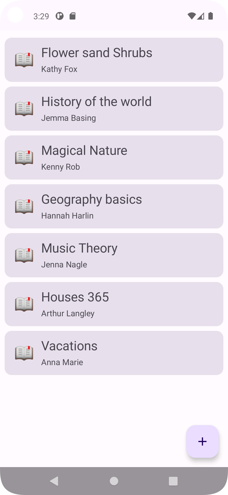
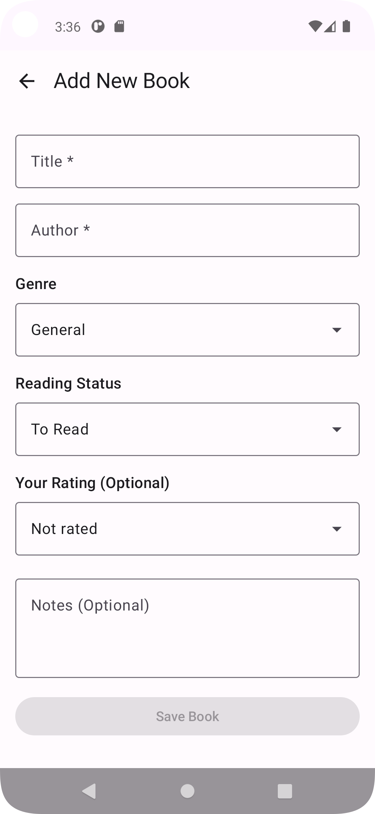
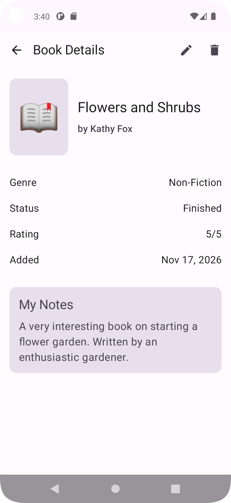

# BookBuddy 📚

BookBuddy is an Android application for organising a personal book collection. Built with **Kotlin**, **Jetpack Compose**, and **Room**, it allows users to track their books, record reading progress, add ratings and notes, and manage their collection.
Originally developed as an academic project, BookBuddy has since been enhanced and tested as part of my graduate Android development portfolio.

## Features

- Add a book with a title, author, genre, reading status, rating and notes.- View books saved locally on the device.
- Tap a book to see its details (including genre, reading status, rating and notes).
- Edit a book's title, author, genre, reading status, rating and notes.
- Delete a book, with a confirmation dialog.
- Preserve book data between app launches using Room.
- Light/dark colour support through Material 3.

## Screenshots

### Bookshelf

### Add Book

### Book Details

**Current limitations:** Book covers currently use placeholder illustrations rather than actual cover images. BookBuddy is a learning and portfolio project, not a published product.

## Technology

- Kotlin and Android Studio
- Jetpack Compose, Material 3 and Navigation Compose
- Room persistence, DAO, Kotlin Flow and coroutines
- Android ViewModel
- JUnit for basic model validation tests

## How to run

1. Install a recent version of Android Studio and Android SDK.
2. Open this folder as an existing project (the folder containing `settings.gradle.kts`).
3. Allow Gradle sync to finish. This is an older project; an IDE-guided Gradle or plugin upgrade may be necessary.
4. Select an Android emulator or Android device, then Run `app`.
5. Add a book, open it, edit it, delete it and restart the app to verify persistence.

**Build verification:** BookBuddy has been successfully built and run in Android Studio using a Pixel 5 Android emulator. Core functionality has been manually tested, including adding, viewing, editing and deleting books, as well as verifying that saved data persists between app launches.

## Next improvements

- [x] Build and test BookBuddy on an Android emulator.
- [ ] Add screenshots of the real app to `docs/screenshots/`.
- [ ] Improve accessibility and layouts for small screens.
- [ ] Add database/DAO tests for adding, updating and deleting books.
- [ ] Consider search or filter, after core functionality is stable.

## Background

This app began as academic coursework and has been revisited to improve maintainability, navigation and data handling. It demonstrates how Android UI state and a local database work together.
